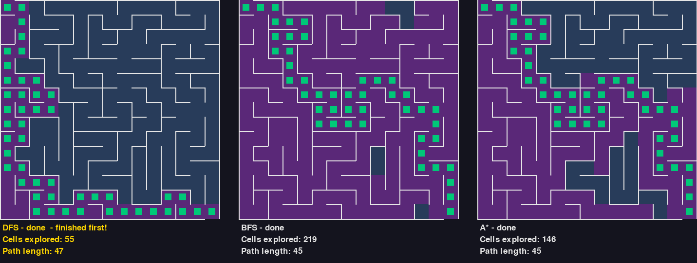

# Maze Solver Race

A Python + pygame program that generates random mazes and races three
pathfinding algorithms against each other on the same maze: **DFS**,
**BFS** and **A\***.



## Features

- Animated maze generation using recursive backtracking (depth-first search)
- Three solvers racing side by side, one step per frame:
  - **DFS** (depth-first search): dives down one corridor at a time
  - **BFS** (breadth-first search): spreads out evenly and always finds the shortest path
  - **A\*** (A-star): uses a distance estimate (Manhattan distance) to head toward the exit, and still finds the shortest path
- Live stats for each solver: cells explored and path length
- Optional loops: knocks down extra walls so the maze has multiple routes

## How to run

You need [uv](https://docs.astral.sh/uv/) installed.

```bash
git clone https://github.com/vehspota/maze-solver.git
cd maze-solver
uv run main.py
